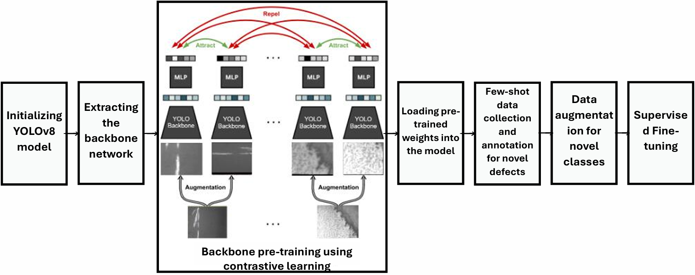

# SSL-YOLO

A semi-supervised approach for few-shot object detection using contrastive learning with YOLOv8.



SSL-YOLO employs a self-supervised approach to pretrain the backbone of YOLOv8 models for few-shot object detection using contrastive representation learning from unlabeled data before supervised fine-tuning on a small labeled dataset.

## Features

- Self-supervised pretraining using contrastive learning
- Support for YOLOv8 model variants (n, s, m, l, x)
- Few-shot object detection capability
- Customizable data augmentation pipeline
- Based on Ultralytics v8.0.117 framework (modified `ultralytics/yolo/engine/trainer.py` file to enable loading and freezing of the pretrained backbone)

## Installation

```bash
git clone https://github.com/Rayen023/ssl-yolo.git
cd ssl-yolo
```

### Using uv (Recommended)

```bash
uv sync
```

### Using pip

```bash
pip install -r requirements.txt
```

## Setup & Configuration

### 1. Prepare Datasets

- **Semi-Supervised Learning**: Collect unlabeled images related to your domain
- **Few-Shot Object Detection**: Prepare a small dataset (~10 images per class) in YOLOv8 format

### 2. Configuration Settings

All parameters are configured in `config.yaml`. Note the required number of classes (nc) must match in your YOLOv8 config.

## Usage

```bash
python ssl_training.py
```

This script will:

- Train the backbone using contrastive learning on unlabeled data
- Save the pretrained backbone weights
- Fine-tune the model on your few-shot dataset with the backbone frozen
- Save the resulting model

## How It Works

### Contrastive Learning Phase

1. **Data Augmentation**: Each image undergoes two different random augmentations
2. **Feature Extraction & Projection**: Both augmented versions pass through the backbone and are projected to a lower-dimensional space
3. **Contrastive Loss**: NT-Xent loss pushes together features from the same image and pulls apart features from different images

### Object Detection Phase

1. **Backbone Transfer**: The pretrained backbone is loaded into a YOLOv8 model
2. **Fine-tuning**: The model is trained on a small labeled dataset (10-shot)
3. **Evaluation**: The model is evaluated on the test set

## Tips for Best Results

1. **Dataset Selection**: Use an unlabeled dataset contextually similar to your target domain
2. **Augmentation Strategy**: Customize based on your specific use case
3. **Batch Size**: Use the largest batch size your GPU memory allows
4. **Training Duration**: Longer pretraining generally leads to better representations
5. **Learning Rate Scheduling**: Adjust for optimal convergence

## Benchmark Results

We evaluated our methodology on the **NEU-DET** dataset in a **10-shot** setting, systematically comparing against various Few-Shot Learning (FSL) representation paradigms. The performance, measured by **Mean Average Precision (mAP@50)**, is summarized below:

| Strategy    | Validation Paradigm                                                | mAP@50 |
| :---------- | :----------------------------------------------------------------- | :----- |
| **ISS-NFT** | In-Domain Self-Supervised pre-training & Novel-class Fine-Tuning\* | 57.1%  |
| **ISS-FFT** | In-Domain Self-Supervised pre-training & Full Fine-Tuning          | 72.9%  |
| **CDT**     | Cross-Domain Transfer (pre-trained on COCO)                        | 32.8%  |

> **\*** _Evaluated on the [FS-ND dataset split](https://github.com/Whileherham/IFDD), SSL-YOLO improved the **mAP@50** from a baseline of **0.127 to 0.571**. [Paper link](https://ieeexplore.ieee.org/document/11394884)._

## Citation

```
@INPROCEEDINGS{11394884,
  author={Ghali, Rayen and Benhafid, Zhor and Selouani, Sid Ahmed},
  booktitle={2025 IEEE Smart World Congress (SWC)},
  title={Benchmarking Few-Shot Learning Techniques for Steel Surface Defect Detection},
  year={2025},
  pages={9-14},
  doi={10.1109/SWC65939.2025.00031}
}
```

## Acknowledgements

- Based on the [Ultralytics YOLOv8](https://github.com/ultralytics/ultralytics) implementation
- Contrastive learning approach based on [SimCLR](https://arxiv.org/abs/2002.05709)
